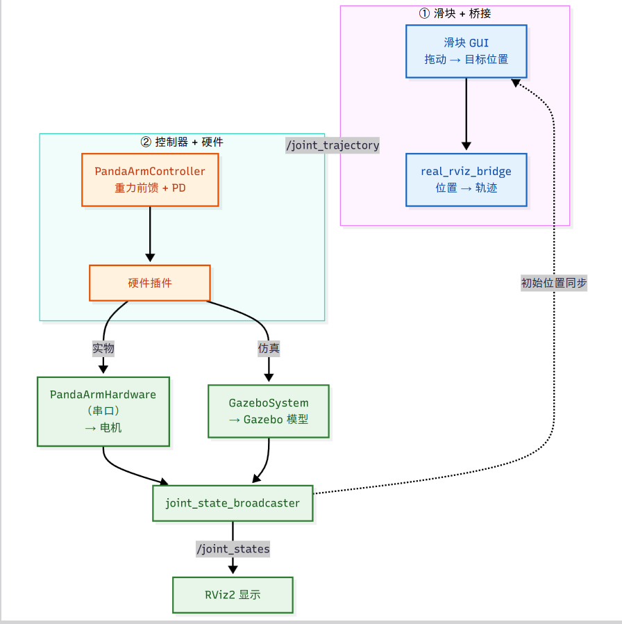

# panda_mpc_arm

7 自由度 Panda 机械臂的 ROS 2（Humble）控制与路径规划仓库。

核心链路：URDF 模型 → ros2_control 硬件抽象 → 电机串口协议 → 重力补偿 + PD 控制；

---

## 目录

- 一、仓库结构
  - ① 模型文件 — `panda_arm_description`
  - ② 硬件交互模块 — `panda_arm_hardware` / `panda_arm_tools`
  - ③ 路径规划模块
  - ④ 配置文件 — `real_arm_config`
- 二、使用方法
  - 0. 编译
  - 1. 仿真（Gazebo 11）
  - 2. 实物
  - 3. 调试标定工具（`panda_arm_tools`）
- 三、测试使用流程
  - 装臂后（实物标定 → 控制）

---

## 一、仓库结构

```
src/
├── panda_arm_description/   # ① 模型文件
├── panda_arm_hardware/      # ② 硬件交互模块（控制 / 协议 / 插件）
├── panda_arm_tools/         # ② 硬件调试标定工具
└── real_arm_config/         # ③ 配置文件夹（配置文件统一放这里）
```

---

### ① 模型文件 — `panda_arm_description`

机械臂的几何与物理模型（URDF + 网格 + Gazebo 标签）。

| 文件 | 功能 |
|---|---|
| `urdf/panda_arm.xacro` | 机械臂本体模型；0 位形 = 手臂竖直向上 |
| `urdf/panda_arm.gazebo` | Gazebo 扩展标签 |
| `meshes/*.stl` | 9 个连杆的 STL 网格 |
| `launch/` | 模型rviz2简单可视化 |

---

### ② 硬件交互模块 — `panda_arm_hardware` / `panda_arm_tools`

**`panda_arm_hardware`（实时控制）**

| 文件 | 功能 |
|---|---|
| `motor_protocol.hpp/.cpp` | J288/S288 电机串口协议：发20B控制包/读26B反馈包、CRC32、减速比换算，在 hardware 调用 |
| `panda_arm_hardware.hpp/.cpp` | ros2_control硬件接口插件，轮询读写 7 个电机，向框架暴露控制和状态接口 |
| `panda_arm_controller.hpp/.cpp` | 控制器插件，支持同时使用力位速度三个接口，兼容仿真和实物|
| `gravity_compensation.hpp/.cpp` | pinocchio 重力补偿 \(g(q)\) |
| `trajectory.hpp/.cpp` | 轨迹采样 / 插值 ，在控制器里调用|
| `real_rviz_bridge.cpp` | 桥接节点：滑块 → `JointTrajectory`（限速、位置差分算速度） |

**`panda_arm_tools`（调试标定）**

| 文件 | 功能 |
|---|---|
| `scripts/slider_gui_deg.py` | 以「度」显示的滑块 GUI，限位自动从 URDF 读取 |
| `src/read_position_node.cpp` | 零力矩读取 7 个电机当前位置并打印 |
| `src/zero_calibrator_node.cpp` | 零位置校准 / 清除，写入 `motor_params.yaml` |
| `src/motor_reader.cpp` / `config_manager.cpp` | 上述两个节点的支撑库 |

---

---

### ④ 配置文件 — `real_arm_config`

| 文件 | 功能 |
|---|---|
| `config/motor_params.yaml` | 电机参数：kp / kd / zero_offset |
| `config/bridge_params.yaml` | 桥接参数：publish_rate / max_velocity |
| `config/gravity_params.yaml` | 重力补偿参数（scale / sign） |
| `config/ros2_controllers.yaml` | 实物 controller_manager 配置（update_rate + 控制器） |
| `config/sim_controllers.yaml` | 仿真 controller_manager 配置（kp/kd 给控制器 PD） |
| `config/panda_arm.urdf.xacro` | 实物 URDF 入口（不含 world 链接） |
| `config/panda_arm.sim.urdf.xacro` | 仿真 URDF 入口（含 world + world_to_base） |
| `config/panda_arm.ros2_control.xacro` | 实物硬件接口（`PandaArmHardware`，三接口） |
| `config/panda_arm.sim.ros2_control.xacro` | 仿真硬件接口（`GazeboSystem`，只 effort） |
| `config/initial_positions.yaml` | 初始位置（已废弃，无人消费） |
| `config/display.rviz` | RViz 显示配置 |
| `launch/slider_control.launch.py` | 实物启动（主用，自定义度滑块） |
| `launch/gazebo_sim.launch.py` | 仿真启动（Gazebo Classic） |

---

## 二、使用方法

### 0. 编译

```bash
cd ~/panda_mpc_arm
colcon build
source install/setup.bash
```

> 改过 `real_arm_config` / `panda_arm_description` 下的 yaml / xacro 后，需重新编译才能生效：
> ```bash
> colcon build --packages-select real_arm_config panda_arm_description && source install/setup.bash
> ```

### 1. 仿真（Gazebo Classic）

```bash
ros2 launch real_arm_config gazebo_sim.launch.py
```

- 用 `sim_controllers.yaml`（只 effort 命令接口），PD 由控制器自己闭环。
- RViz 里拖动滑块即可控制 Gazebo 中的机械臂。

### 2. 实物

```bash
ros2 launch real_arm_config slider_control.launch.py serial_port:=/dev/ttyACM0
```

- 用 `ros2_controllers.yaml`（position/velocity/effort 三接口），PD 由电机板完成。
- 参数 `serial_port` 按实际串口设备调整（默认 `/dev/ttyACM0`）。

### 3. 调试标定工具（`panda_arm_tools`）

> 串口同一时刻只能被一个进程打开，运行这些节点前先停掉实物 launch。

```bash
# ① 读取 7 个电机当前位置（一次性打印后退出）
ros2 run panda_arm_tools read_position_node --ros-args -p serial_port:=/dev/ttyACM0

# ② 零位校准：把当前姿态标定为零位（写入 motor_params.yaml）
ros2 run panda_arm_tools zero_calibrator_node --ros-args -p serial_port:=/dev/ttyACM0

# ③ 清除零位：把 zero_offsets 全部置 0（不需要串口）
ros2 run panda_arm_tools zero_calibrator_node --ros-args -p clear:=true
```

---

## 三、典型工作流

### 装臂后（实物标定 → 控制）

```bash
# 1. 扫描确认电机在线
ros2 run panda_arm_tools read_position_node --ros-args -p serial_port:=/dev/ttyACM0

# 2. 把臂摆到机械零位并校准
ros2 run panda_arm_tools zero_calibrator_node --ros-args -p serial_port:=/dev/ttyACM0

# 3. 启动正常控制
ros2 launch real_arm_config slider_control.launch.py serial_port:=/dev/ttyACM0
```

---

## 四、滑块控制流程图

① 滑块 + 桥接：拖动滑块得到目标位置，经 `real_rviz_bridge` 转成 `/joint_trajectory` 轨迹；同时 `joint_state_broadcaster` 的 `/joint_states` 反馈回桥接节点做初始位置同步。

② 控制器 + 硬件：`PandaArmController`（重力前馈 + PD）接收轨迹后下发给硬件插件，实物走 `PandaArmHardware`（串口 → 电机），仿真走 `GazeboSystem`（→ Gazebo 模型），状态再由 `joint_state_broadcaster` 汇总给 RViz2 显示。




